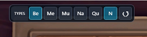
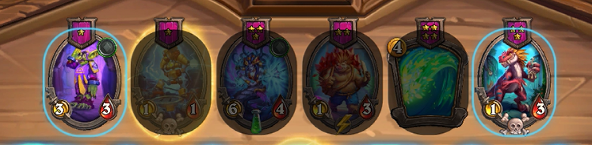
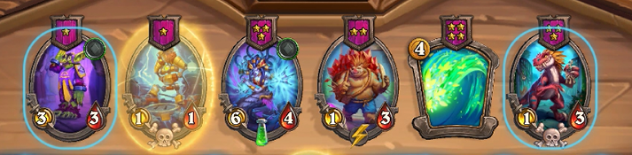
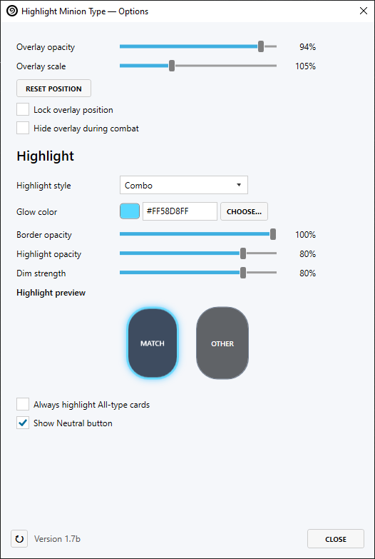

# HDT Highlight Minion Type

HDT Highlight Minion Type is a plugin for [Hearthstone Deck Tracker](https://github.com/HearthSim/Hearthstone-Deck-Tracker) that highlights Battlegrounds minions of selected types in Bob's Tavern during the shopping phase.

The plugin helps you quickly find matching minions without highlighting your hand or warband. It is intended for the Windows version of HDT.

## Screenshots

### In game

### Settings

## Features

* Shows the minion types available in the current Battlegrounds lobby
* Highlights only cards shown in Bob's Tavern, never your hand or warband
* Includes types with left-click and excludes them with right-click
* Supports multiple simultaneous selections
* Handles dual-type, All-type and typeless minions
* Provides Glow/Border, Dim others and Combo highlight styles
* Includes separate opacity controls for the border, highlight and dimming
* Shows a live preview of the selected highlight style
* Supports overlay opacity, scale, positioning and position locking
* Can remain visible or hide during combat while card highlighting stays disabled
* Saves settings between HDT sessions
* Includes a manual update check in the settings window
* Works locally without telemetry, analytics or gameplay data uploads

## How to use

Left-click a type button to include that minion type. Right-click it to exclude the type. Exclusions have priority when a minion has more than one type.

Select several type buttons to highlight any matching minion. Use the `↻` button on the overlay to clear every selection.

The overlay reads only Bob's Tavern during the shopping phase. It does not highlight cards on your warband or in your hand, and highlighting is always disabled during combat.

## Limitations

HDT Highlight Minion Type supports **Battlegrounds only**.

The available minion types and card positions depend on data exposed by the installed HDT version. If HDT cannot provide matching shop geometry, the plugin skips highlighting instead of drawing over an uncertain card.

## Configuration

Open:

`Options -> Tracker -> Plugins -> Highlight Minion Type -> Options`

Available settings include:

* Overlay opacity and scale
* Overlay position reset and position locking
* Overlay visibility during combat
* Highlight style and glow color
* Border opacity
* Highlight opacity
* Dim strength
* All-type minion behavior
* Neutral button visibility

Use the `↻` button beside the installed version to check for a newer GitHub release. The check only runs when the button is pressed and does not download or install files automatically.

## Installation

Download the latest release from:

https://github.com/numbereleven-a/HDT-Highlight-Minion-Type/releases/latest

Then install it using one of the standard HDT plugin methods.

### Drag and drop

1. Open `Options -> Tracker -> Plugins`
2. Drag the downloaded `.zip` or `.dll` into the plugins window
3. Restart HDT
4. Enable `Highlight Minion Type`

### Manual install

1. Extract `HDTHighlightMinionType.dll` from the release archive into `%appdata%\HearthstoneDeckTracker\Plugins`
2. Restart HDT
3. Enable `Highlight Minion Type` in `Options -> Tracker -> Plugins`

If the plugin does not appear, right-click `HDTHighlightMinionType.dll`, open `Properties`, and click `Unblock`.

## License

HDT Highlight Minion Type is available under the [MIT License](LICENSE).

## Download

